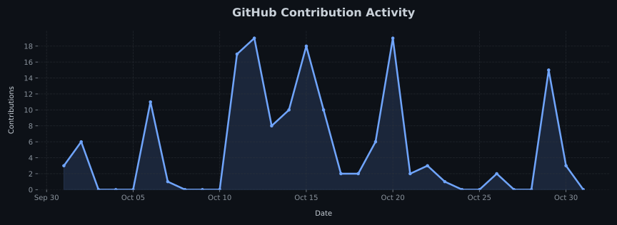

# Hi, I'm Keshab Bhandari 👋

### Computer Engineering Undergraduate | Full-Stack & Backend Development

Building practical software with an interest in scalable systems, clean architecture, and reliable APIs.

 

---

## 💫 About Me

I'm a **Computer Engineering undergraduate at Pokhara University** interested in software engineering, full-stack applications, backend architecture, and scalable system design.

- 🔭 Building real-world projects and strengthening my software engineering skills.
- 🌱 Learning RESTful API development, database design, modern web frameworks, and AI-powered applications.
- 🧠 Studying data structures, algorithms, computer architecture, and software design principles.
- 🎯 Prioritizing readable code, maintainability, security, and performance.

---

## 💻 Tech Stack

### Languages

### Frontend & Mobile

### Backend & Databases

### Tools & Platforms

---

## 📊 GitHub Statistics

<!-- Private metrics require an authenticated, self-hosted stats service. -->

---

## 📈 GitHub Contribution Activity

<!-- BEGIN ACTIVITY-GRAPH -->
<picture>
  <source media="(max-width: 767px)" srcset="activity-graph-mobile.svg">
  
</picture>
<!-- END ACTIVITY-GRAPH -->

## 🌐 Let's Connect

I'm interested in discussing practical software projects, backend systems, web development, and engineering ideas.

📩 **Email:** [bhandarikeshab284@gmail.com](mailto:bhandarikeshab284@gmail.com)

---

**Thanks for visiting! ⭐ Explore my repositories below.**

